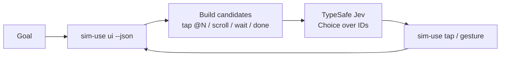

# jev-sim

**Fast mobile-simulator computer-use.**

[sim-use](https://github.com/lycorp-jp/sim-use) observes and acts on iOS / Android simulators.
[TypeSafe Jev](https://typesafe.ai) chooses the next action from a **bounded candidate list**.

Same architecture as [Cua jev-use](https://github.com/trycua/cua) — observe → build candidates in code → Jev Choice over IDs → execute — but the driver is **sim-use**, not Cua Driver.



## Why

Traditional computer-use asks a large LLM to *generate* the next click. That is slow, expensive, and hard to verify.

**jev-sim** keeps code in control:

1. **sim-use** returns a compact accessibility outline + `@N` aliases.
2. **jev-sim** deterministically turns entries into candidates `{id, kind, selector, label}`.
3. **Jev** (`jev-1.13.0` by default) answers a typed **Choice** over those IDs (+ `done` / `scroll-up` / `scroll-down` / `wait`).
4. **sim-use** executes `tap @N` or a gesture; we re-observe and log latency + confidence.

## Install

### 1. sim-use (Mac host with Simulator / emulator)

```bash
brew tap lycorp-jp/tap
brew install lycorp-jp/tap/sim-use
# Homebrew 6.0.5+: brew trust lycorp-jp/tap   # if needed
sim-use --version
sim-use devices
```

### 2. jev-sim

```bash
pip install -e ".[dev]"
# or from GitHub once published:
# pip install git+https://github.com/Aben25/jev-sim.git
```

### 3. TypeSafe API key

```bash
cp .env.example .env
# edit .env — set TYPESAFE_API_KEY=...
export TYPESAFE_API_KEY=...   # never commit this
```

## CLI

```bash
jev-sim doctor              # sim-use on PATH? key present? devices?
jev-sim dry-run "Open General" --ui-file tests/fixtures/ui_settings.json --list-only
jev-sim dry-run "Open General" --ui-file tests/fixtures/ui_settings.json
jev-sim step "Open General settings" --device "$UDID"
jev-sim loop "Enable Dark Mode" --device "$UDID" --max-steps 15
jev-sim step "…" --dry-run  # decide only
jev-sim loop "Enable Dark Mode" --backend rizzo --max-steps 30 --trace ./decisions.jsonl
jev-sim dry-run "Open General" --backend tev1 --ui-file tests/fixtures/ui_settings.json --trace ./decisions.jsonl
```

`--backend` accepts `jev` (hosted model `jev-1.13.0`), `rizzo` (the pinned native endpoint), or `tev1` (the digest-pinned Ollama System One endpoint). A selected backend failure stops the command. The CLI does not start local model services. Local choices with one candidate select that candidate in code and skip the provider call.

`--trace PATH` appends one JSON object per attempted step. Each record includes the backend and model, candidate and selected IDs, probabilities, timings, outcome, and error details. The trace excludes credentials and raw UI data.

`loop` accepts `--max-steps 30` (also `--max-steps=30`) and takes the shared device lock. The backend, trace, candidate, probability, and lock contracts are described in [Backend, trace, and shared-lock guide](docs/backend-trace-locks.md).

The agent only chooses from generated tap, scroll, wait, and done candidates. It does not generate text or type into fields. Local providers accept up to 26 choices per call; jev-sim handles larger sets with an ordered hierarchy and marks the resulting probabilities as derived and uncalibrated. Candidate-generation limits and consequences are documented in the guide.

## Live on a Mac (later)

```bash
# Boot an iOS Simulator (or Android emulator), then:
export TYPESAFE_API_KEY=…          # from https://typesafe.ai
export UDID=$(sim-use devices --json | …)   # or copy from `sim-use devices`

jev-sim doctor
jev-sim step "Open Settings → General" --device "$UDID"
jev-sim loop "Turn on Dark Mode" --device "$UDID" --max-steps 20 -v
```

Each step logs something like:

```text
choice=@9 conf=0.910 observe=320ms decide=45ms exec=80ms total=450ms [exec]
```

## Architecture vs Cua jev-use

| Layer | Cua jev-use | **jev-sim** |
|---|---|---|
| Observe / act | Cua Driver (macOS / Windows / Linux desktop) | **sim-use** (iOS Simulator + Android) |
| Candidates | Deterministic from AX / DOM / perception | Deterministic from `sim-use ui --json` `entries` |
| Decision | TypeSafe **Jev** Choice over IDs | Same — `POST /v1/systemone` model `jev-1.13.0` |
| Meta actions | done / scroll / wait (etc.) | `done`, `scroll-up`, `scroll-down`, `wait` |

jev-sim does **not** vendor or clone sim-use source; it shells out to the CLI only.

## Library

```python
from jev_sim import run_step, build_candidates
from jev_sim.sim_use import SimUseClient
from jev_sim.typesafe import TypeSafeClient

result = run_step(
    "Open General",
    sim=SimUseClient(device=udid),
    jev=TypeSafeClient(),  # reads TYPESAFE_API_KEY
)
print(result.summary_line())
```

## Tests

```bash
pip install -e ".[dev]"
pytest                  # offline unit tests (mocked HTTP + fixture UI)
pytest -m integration   # optional live TypeSafe / sim-use (needs key + binary)
```

## Agent skill

See [`skills/jev-sim/SKILL.md`](skills/jev-sim/SKILL.md) for Claude Code / Codex / Cursor agents.

## License

MIT — see [LICENSE](LICENSE).

Suggested GitHub repo: **[Aben25/jev-sim](https://github.com/Aben25/jev-sim)**
